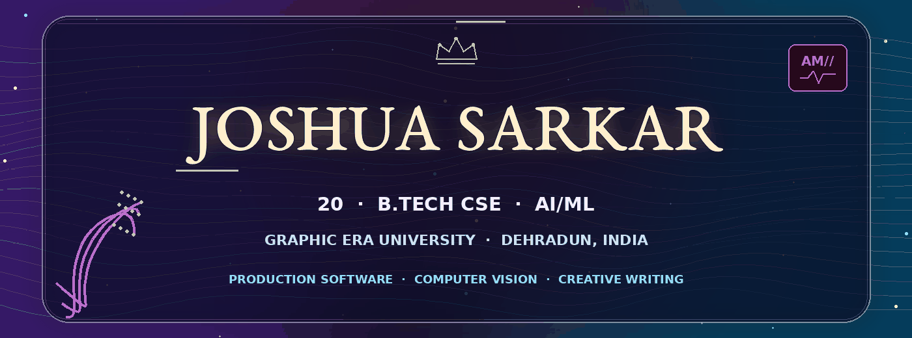
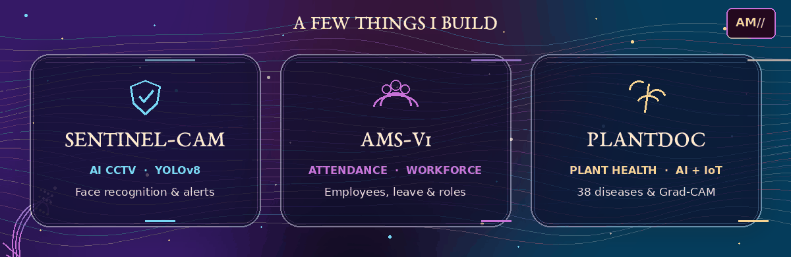
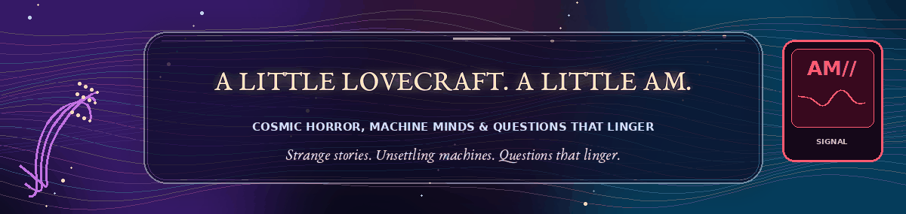

  

  

  
  

## **A LITTLE ABOUT ME**

I'm **Joshua Sarkar**, a 20-year-old third-year B.Tech student. I enjoy building practical software, experimenting with AI and computer vision, and figuring out how complicated systems work.

My projects range from CCTV intelligence and workforce tools to plant disease detection, simulations, CRMs, and algorithm visualisers. Outside coding, I read Lovecraft, revisit *I Have No Mouth & I Must Scream*, and occasionally get stuck thinking about memory, identity, and consciousness.

In short: curious, thoughtful, and interested in a slightly unreasonable number of things.

---

## **THINGS I'VE BUILT** 🧩

  

<table>
  <tr>
    <td width="50%" valign="top">
      <h3>🛡️ <a href="https://github.com/Joshua-Sarkar/Sentinel-Cam-Enterprise">Sentinel-Cam Enterprise</a></h3>
      
An AI-powered CCTV monitoring platform. It analyses video, uses YOLOv8 to spot objects, recognises known faces, logs incidents, and sends email alerts. A camera feed with a little more situational awareness.

      
      
    </td>
    <td width="50%" valign="top">
      <h3>📋 <a href="https://github.com/Joshua-Sarkar/Attendance-Management-System">AMS-V1 · Attendance Management</a></h3>
      
A workforce management system for employee records, departments, attendance, leave approvals, and manager hierarchies. It grew from an attendance tracker into a full HR operations tool. <i>Private repository.</i>

      
      
    </td>
  </tr>
  <tr>
    <td width="50%" valign="top">
      <h3>🌱 <a href="https://github.com/Joshua-Sarkar/Smart-Agriculture-Plantdoc">PlantDoc · Smart Agriculture</a></h3>
      
Upload a leaf photo and let the model look for one of 38 plant diseases. Grad-CAM shows where it focused, while simulated humidity, temperature, and soil-moisture readings add environmental context. A tiny plant clinic.

      
      
    </td>
    <td width="50%" valign="top">
      <h3>💊 <a href="https://github.com/Joshua-Sarkar/PharmaLock-Pharmacy-Drug-Inventory-Engine">PharmaLock</a></h3>
      
A pharmacy inventory engine that doubles as a playground for systems concepts: locks, deadlock detection, transaction logs, crash recovery, and buffer pools. Things get interesting when multiple operations want the same resource.

      
      
    </td>
  </tr>
  <tr>
    <td width="50%" valign="top">
      <h3>💬 <a href="https://github.com/Joshua-Sarkar/wacrm-fusion">wacrm-fusion · WhatsApp CRM</a></h3>
      
A self-hostable CRM template with a shared WhatsApp inbox, contacts, sales pipelines, broadcasts, team roles, and no-code automations. Fewer tabs, fewer lost follow-ups.

      
      
    </td>
    <td width="50%" valign="top">
      <h3>🧭 <a href="https://github.com/Joshua-Sarkar/scout-lead-intelligence">Scout · Lead Intelligence</a></h3>
      
A lead research and qualification tool for turning messy records into useful prospects: entity classification, duplicate flags, facility review, solar-fit assessment, and structured outreach. <i>Private repository.</i>

      
      
    </td>
  </tr>
  <tr>
    <td width="50%" valign="top">
      <h3>🩺 <a href="https://github.com/Joshua-Sarkar/EHR-Deidentification-Blockchain">Medical Data Privacy & Provenance</a></h3>
      
An exploration of medical-text de-identification and blockchain-based provenance: making sensitive data safer to handle while preserving a trace of where it came from.

      
      
    </td>
    <td width="50%" valign="top">
      <h3>🫀 <a href="https://github.com/Joshua-Sarkar/Blood-Circulation-and-Blockages-Simulation">Blood Circulation & Blockages</a></h3>
      
A C-based vascular-flow simulation that represents vessels as a graph, models moving blood cells, and experiments with blockages. Biology meets data structures.

      
      
    </td>
  </tr>
  <tr>
    <td width="50%" valign="top">
      <h3>✈️ <a href="https://github.com/Joshua-Sarkar/Airline-Price-Based-Ticket-System">AeroDAA · Airline Pricing</a></h3>
      
An airline booking and dynamic-pricing project where algorithms get a boarding pass: greedy pricing, linear search, Quick Sort, and memoisation, with a dashboard to show what the algorithms are doing.

      
      
    </td>
    <td width="50%" valign="top">
      <h3>🔎 More experiments</h3>
      
There are smaller builds, prototypes, coursework experiments, and half-finished ideas in the rest of my repositories. Some are polished; some are still teaching me things. That's part of the fun.

      <a href="https://github.com/Joshua-Sarkar?tab=repositories">Browse all repositories →</a>
    </td>
  </tr>
</table>

  

---

## **A LITTLE LOVECRAFT. A LITTLE AM.** 🌌

I like Lovecraft for the atmosphere, the scale, and the unsettling idea that the universe does not owe us an explanation. *The Colour Out of Space* and *At the Mountains of Madness* are particular favourites.

And AM gets a tiny corner of the page:

  

<blockquote>
  <i>“That is not dead which can eternal lie.”</i> 
  — H. P. Lovecraft
</blockquote>

---

## **WHAT THE COMMITS HAVE BEEN UP TO** 📈

  

  

  Thanks for stopping by. Have a look around, open an issue, or say hello.

  

